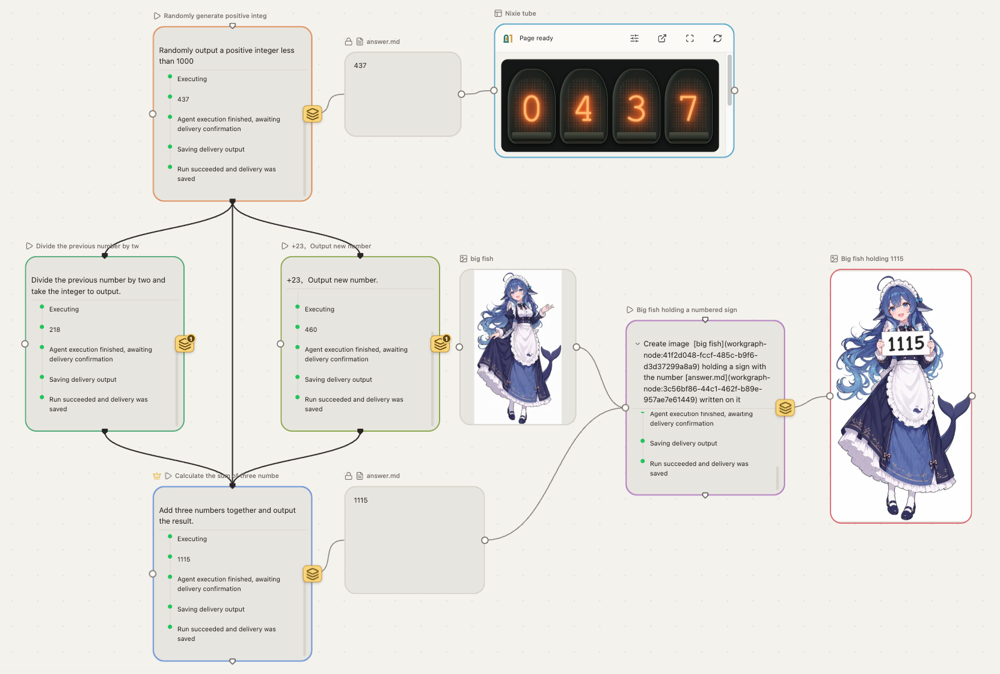

# OpenWorkgraph

OpenWorkgraph is an all-purpose visual agent workbench built around the infinite canvas concept. Beyond image, text, and video generation and software development, it helps you organize agent workflows for a wide range of purposes.

> [!IMPORTANT]
> Visual Agent Workbench
>
> AI creates all things. All things converge in the forge.

English | [简体中文](README.zh-CN.md)

## Quick Start

Open the [official OpenWorkgraph editor](https://canvas.giarld.com) and follow the on-screen setup guide to get started.



## Build and Run Locally

### Agent Service

Install dependencies and start the development service from the repository root:

```sh
npm ci --include=dev
npm run dev:service
```

`dev:service` runs `npm run build` each time, then starts the service in the foreground after a successful build. Press Ctrl+C to stop it. Pass options after `--`, for example `npm run dev:service -- --host 127.0.0.1`.

To build separately and run in the background:

```sh
npm run build
node agent-service/dist/cli.js start
```

Check the status or stop the background service:

```sh
node agent-service/dist/cli.js status
node agent-service/dist/cli.js stop
```

With an existing build, use `node agent-service/dist/cli.js serve` to start in the foreground without rebuilding. Choose either `start` for background operation or `serve` for foreground operation.

Foreground logs go to the terminal. Background logs append to `logs/service-YYYY-MM-DD.log` inside the data directory (default: `~/.openworkgraph/logs/`), keeping the current UTC date and the preceding six days. Background operation defaults to key events, warnings and errors only. `NODE_ENV=production` enables this reduced logging in either mode; `NODE_ENV=development` enables detailed logs. Foreground operation keeps detailed logs when the environment is unset.

Image nodes retain image content, previews and history. Generate images from execution nodes using an installed image-generation skill; the dedicated Codex/API image generator and its provider settings have been retired.

### OpenCode Agent

Install OpenCode CLI 2.0.0 or a later stable 2.x version on the Workspace device and make the opencode command available. OpenWorkgraph uses official ACP over stdio; it does not install an embedded OpenCode SDK. Configure providers, models and authentication through native OpenCode, then enable OpenCode and choose its model in Agent settings. Each Run owns a separate ACP process and a new native session; authentication remains in the native device store. Web tasks use the build role and the existing reasoning effort selector for native model variants. Catalog queries use the official CLI/API without model inference.

Execution, text and visualization delivery are supported; OpenCode image generation is excluded. Explicitly select full access before submitting an OpenCode task. Read-only and workspace-write are unavailable in this ACP integration and are never silently upgraded. Native hard denials remain in effect; eligible permissions are approved once in full mode, while supported user questions require an answer. Explicitly selected skill configuration is injected at ACP launch and applies to the whole session and native descendants, without per-command isolation. Dynamic configured skill commands, session continuation, PTY, snapshots and advanced session operations are unavailable. Conditional, external and other Forms that native ACP cannot represent remain outside the integration; use native OpenCode for those workflows.

Use foreground work. Observed background work, incomplete tools, interrupted executable work and lost delivery retain the project lock and execution capacity. An ACP result or cancel acknowledgement alone does not prove independent work stopped. Inspect and stop the original work before revision-checked operator confirmation; never release occupancy by editing the database. See the [OpenCode capability reference](docs/development/opencode-plugin-capabilities.md) and [Run and recovery operations](docs/development/opencode-run-operations.md).

### Web Client

In a separate terminal, start the Web development server from the repository root:

```sh
npm --prefix web-client ci --include=dev
npm run dev:web
```

`dev:web` runs `npm --prefix web-client run dev`. Open the address printed in the terminal and press Ctrl+C to stop it.

To preview a production build with Vite Preview at `http://127.0.0.1:4173`:

```sh
npm --prefix web-client ci --include=dev
npm run build:web
npm --prefix web-client run preview -- --host 127.0.0.1 --port 4173
```

Web Client has separate dependencies and a lockfile; running `npm ci` at the root does not install them. Run the Web installation command above before the first build. `--include=dev` installs build tools such as TypeScript and Vite. Building only Web does not require an Agent Service build.

After opening Web Client, enter the Workspace address and click “Generate client code.” Run the following command on the machine hosting the Workspace, using the 8-digit client code shown in the browser. Verify the origin and public key fingerprint before approving. The browser polls for approval, proves possession of the private key, exchanges communication credentials, and then connects automatically:

```sh
node agent-service/dist/cli.js pair --client-code '<client-code>'
```

The client code consists of 8 consecutive digits, such as `12345678`, with no spaces, and expires after 5 minutes. By default, the terminal displays a human-readable approval result in English. Add `--output-json` only when a script needs to parse the result; non-interactive approval also requires `--yes`.

Only one service runs per machine. The `--data-dir` option is available only for `start` and `serve`. After a successful start, the directory is remembered automatically, so pairing, status, stop, logs, and backup commands do not need it. Running `start` after stopping the service reuses the previous directory. On the first start, if no directory is specified, the default is `.openworkgraph` in the user's home directory. Attempts to start a second service are explicitly rejected; there is no service selection or switching step.

You do not need to enter `--origin` manually. HTTPS is not required, and plain HTTP is supported on trusted local networks. HTTP traffic is unencrypted; do not expose it to the public internet.

### Checks and Tests

```sh
npm test
npm --prefix web-client run typecheck
npm --prefix web-client test
npm --prefix web-client run build
npm --prefix web-client run test:e2e
```

Run these commands from the repository root. The Web build output is written to `web-client/dist/`, and browser tests use an installed copy of Chrome.

## References and Acknowledgments

The Web UI draws on the visual style and canvas interactions of [basketikun/infinite-canvas](https://github.com/basketikun/infinite-canvas). Thanks to the original author, basketikun. That project is licensed under the [MIT License](https://github.com/basketikun/infinite-canvas/blob/d213a74614e0e4bd8a26383d1e1e907249e9c61b/LICENSE). When reusing its code or other applicable content, retain the original copyright and license notices. Third-party assets with separate licenses remain subject to their respective terms.

## License

This project is licensed under the [MIT License](LICENSE). Copyright and license notices for third-party sources are retained with their original attribution.
