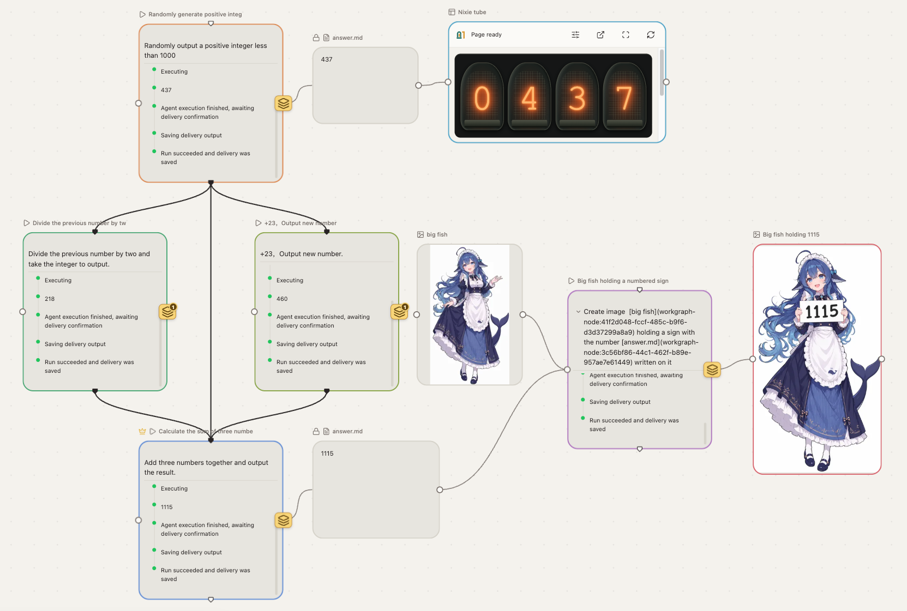

# 万象画布（OpenWorkgraph）

万象画布（OpenWorkgraph）是基于无限画布思想的全能可视化智能体工作台产品，除了图、文、视频生成、软件开发等工作，还能组织各种用途的 Agent 工作流。

> [!IMPORTANT]
> 可视化智能体工作台
>
> AI造万象，万象归熔炉。

[English](README.md) | 简体中文

## 快速开始

打开 [万象画布官方编辑器](https://canvas.giarld.com)，按照页面提供的引导完成配置即可开始使用。



## 本地构建与运行

### Agent Service

在仓库根目录安装依赖并启动开发服务：

```sh
npm ci --include=dev
npm run dev:service
```

`dev:service` 每次先执行 `npm run build`，构建成功后以前台方式启动服务，按 Ctrl+C 关闭。参数可通过 `--` 传入，例如 `npm run dev:service -- --host 127.0.0.1`。

如需独立构建并后台运行，使用以下命令：

```sh
npm run build
node agent-service/dist/cli.js start
```

查看状态或停止后台服务：

```sh
node agent-service/dist/cli.js status
node agent-service/dist/cli.js stop
```

已有构建可使用 `node agent-service/dist/cli.js serve` 直接前台启动，无需重新构建。`start` 为后台运行，`serve` 为前台运行，两者择一使用。

前台日志输出到终端；后台日志追加到数据目录下的 `logs/service-YYYY-MM-DD.log`（默认 `~/.openworkgraph/logs/`），按 UTC 日期保留当天及前 6 天。后台默认只记录关键事件、警告和错误；`NODE_ENV=production` 对前后台均启用精简日志，`NODE_ENV=development` 启用详细日志，未设置环境的前台保留详细日志。

### OpenCode 执行器

OpenCode 集成依赖由万象画布安装流程自动配置，无须单独安装 SDK。最低支持 OpenCode 2.0.0（稳定版 >= 2.0.0），由工作空间为每次执行启动独立原生实例，不接管用户已有会话。在工作空间设备使用 OpenCode 原生方式配置提供商、模型及认证，再到 Agent 设置页启用并选择模型；Web 使用固定的 build 角色，提交前可通过与 Codex 相同的思考强度选择框调节原生模型变体，由插件转换参数。目录查询不触发模型推理。若提示集成依赖未安装完整，在工作空间设备执行 `npm install -g openworkgraph --include=optional`，然后重启工作空间并刷新 Agent 目录；显式省略可选依赖会跳过 OpenCode 集成。

支持执行、文本及可视化交付，不提供 OpenCode 生图。项目可写模式使用原生文件规则与命令审批，不是 OS 沙箱；只读模式暂不支持。全访问模式自动批准可批准的权限请求，仍保留原生硬拒绝，用户问题需自行答复。高级会话、回退及终端操作通过后端 API 使用，Web 没有新增这些入口。

崩溃后若独立工作尚未确认结束，会继续保留项目锁和执行占用。先核对并停止原工作，再使用有修订校验的恢复操作；不要直接修改数据库释放占用。实现、安装与平台边界见 [OpenCode 能力说明](docs/development/opencode-plugin-capabilities.md)和[运行与恢复操作](docs/development/opencode-run-operations.md)。

### Web Client

在另一个终端中，从仓库根目录启动 Web 开发服务：

```sh
npm --prefix web-client ci --include=dev
npm run dev:web
```

`dev:web` 等同于 `npm --prefix web-client run dev`，访问地址以终端输出为准，按 Ctrl+C 关闭。

如需预览生产构建，通过 Vite Preview 在 `http://127.0.0.1:4173` 运行：

```sh
npm --prefix web-client ci --include=dev
npm run build:web
npm --prefix web-client run preview -- --host 127.0.0.1 --port 4173
```

Web Client 使用独立的依赖和锁文件，根目录的 `npm ci` 不会安装 Web 依赖。首次构建须执行上述 Web 安装命令；`--include=dev` 确保安装 TypeScript、Vite 等构建工具。仅构建 Web 无需先运行 Agent Service 构建。

打开 Web Client 后，填写工作空间地址并点击“生成客户端码”。在工作空间所在机器执行以下命令，输入浏览器显示的 8 位客户端码，核对来源和公钥指纹后确认；浏览器会轮询批准状态，完成私钥证明和通讯凭据交换后自动连接：

```sh
node agent-service/dist/cli.js pair --client-code '<客户端码>'
```

客户端码显示为连续 8 位数字，例如 `12345678`，中间没有空格，5 分钟有效。终端默认输出英文可读的批准结果；仅脚本需要解析时加 `--output-json`（非交互批准还需 `--yes`）。

一机只运行一个服务。`--data-dir` 仅用于 `start` 和 `serve`；启动成功后自动记住目录，配对、查看状态、停止、日志和备份命令都无需再填写。停服后运行 `start` 会沿用原目录，首次启动未指定时使用用户主目录下的 `.openworkgraph`。重复启动会明确拒绝，不提供服务选择或切换步骤。

无需手填 `--origin`，不强制 HTTPS，支持可信局域网普通 HTTP。HTTP 不加密，请勿暴露公网。

### 检查与测试

```sh
npm test
npm --prefix web-client run typecheck
npm --prefix web-client test
npm --prefix web-client run build
npm --prefix web-client run test:e2e
```

以上命令在仓库根目录执行；Web 构建输出为 `web-client/dist/`，浏览器测试使用已安装的 Chrome。

## 参考依据与致谢

Web UI 参考了 [basketikun/infinite-canvas](https://github.com/basketikun/infinite-canvas) 的视觉风格和画布交互，感谢原作者 basketikun。该项目采用 [MIT License](https://github.com/basketikun/infinite-canvas/blob/d213a74614e0e4bd8a26383d1e1e907249e9c61b/LICENSE)；复用其代码或其他适用内容时，应保留原版权与许可声明。第三方素材若有独立授权，以其各自许可为准。

## 许可证

本项目采用 [MIT License](LICENSE)。第三方来源的版权与许可声明按原始归属保留。
